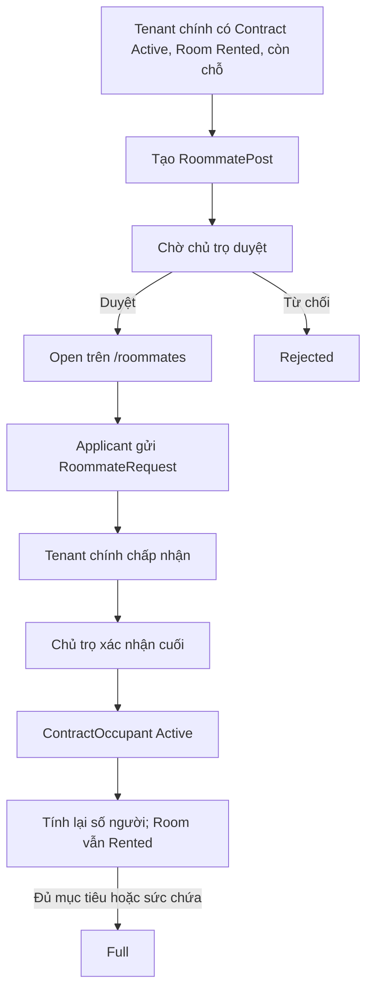

# Module tìm người ở ghép

Ngày kiểm tra: 15/10/2026. Phạm vi đã được người dùng duyệt: bổ sung Roommate và tích hợp tối thiểu vào lifecycle hợp đồng. Không commit/push.

## Nghiệp vụ

Người ở ghép không phải một hợp đồng thuê độc lập. Hợp đồng chính và nghĩa vụ thanh toán với chủ trọ vẫn thuộc Tenant chính. Hệ thống chỉ quản lý số người cư trú và quy trình tìm/xác nhận người ở ghép.



- Chỉ Tenant chính của hợp đồng Active, trong thời gian thuê và Room Rented được đăng tin. Danh mục Room không giới hạn quyền này.
- PendingSignature/PendingStart/Expired/Terminated/Cancelled không được đăng hoặc nhận người mới.
- Chủ trọ duyệt đúng hợp đồng của mình. Admin không được xử lý thay vai trò Landlord trong module.
- `EstimatedShare` chỉ tham khảo; không tạo cọc, hợp đồng, hóa đơn hoặc giao dịch thanh toán riêng cho roommate.
- `RequestedSlots` là mục tiêu tuyển thêm của tin. Số còn nhận bằng RequestedSlots trừ số yêu cầu đã Approved của tin; luôn bị giới hạn bởi chỗ thực tế. Đủ mục tiêu vẫn Full dù Room còn sức chứa.
- Full không tự mở lại khi một người rời. Tenant chính tạo tin mới và xin duyệt lại nếu còn chỗ.
- Sửa tin cần duyệt lại; yêu cầu chưa hoàn tất của nội dung cũ bị hủy. Đóng tin hoặc đạt Full cũng hủy các yêu cầu Pending/Accepted chưa hoàn tất.
- Người thuê chính hoặc chủ trọ xác nhận roommate rời. Người thuê chính không được biến thành occupant phụ.

## Nguồn số người cư trú

`ContractOccupancyPolicy.CountAsync` là hàm đếm dùng chung; `RecalculateCurrentOccupantsAsync` cập nhật cache Room.CurrentOccupants.

```text
CurrentOccupants = số Contract Active của Room
                 + số ContractOccupant Active thuộc các Contract Active đó
AvailableSlots   = MaxOccupants - CurrentOccupants
```

Luồng thông thường chỉ có một hợp đồng hiệu lực: 1 Tenant chính + roommate Active. Không có Contract Active thì bằng 0. PendingStart chưa tính người thuê chính. Không dùng ++/-- làm cơ chế cập nhật. Không tin các giá trị số người/chỗ trống do client gửi.

Các mutation dùng transaction Serializable và WorkflowLock hiện tại. Duyệt cuối đọc lại trạng thái, người cư trú và sức chứa, thêm occupant rồi tính lại trong cùng transaction. Không cho giảm MaxOccupants xuống dưới số người thực tế.

## Tích hợp lifecycle

Trong `RentalContractBLL` tại `BLL/RentalFeaturesBLL.cs`:

- `XacNhanAsync`: sau khi lưu chữ ký/trạng thái, tính lại số người cùng transaction. PendingStart = 0; Active tính Tenant chính.
- `ExpireEndedContractsAsync`: PendingStart tới ngày bắt đầu chuyển Active rồi tính lại. Hết hạn đóng tin/requests/occupants trước khi lưu và tính lại; giữ guard giải phóng Room hiện có.
- `ChamDutAsync`: đóng tin, hủy requests chưa hoàn tất, kết thúc occupants; lưu và tính lại số người trước commit. Không tự bỏ qua reservation/hợp đồng khác.
- `ReconcileContractLifecycleAsync`: hợp đồng chờ ký bị Cancelled cũng được cleanup và tính lại.
- `RentalLifecycleHostedService`: gọi thêm RoommateBLL.ReconcileLifecycleAsync sau lifecycle hợp đồng. Đối soát hợp đồng terminal và số người là idempotent.

Hàm cleanup chỉ đổi trạng thái dữ liệu Roommate và cache Room; không sửa tiền thuê, tiền cọc, giá điện/nước/phí dịch vụ của Contract. Requests đã Approved được giữ làm lịch sử; occupant có LeftAt.

## Schema đề xuất, chỉ đã áp trên QA

Script versioned: `backend/RoomRental.BackEnd/SQL/07_RoommateModule.sql`. Project hiện dùng versioned SQL, không thêm EF Migration song song.

Script từ chối chạy nếu database không có prefix `RoomRental_Verification_`. Không DROP/TRUNCATE, không sửa/xóa dữ liệu lịch sử. Nếu chỉ tồn tại một phần ba bảng thì dừng. Kiểm tra apply trên schema cũ: 24 bảng -> 27 bảng; chạy lần hai không đổi.

| Entity / bảng | Cột |
| --- | --- |
| RoommatePost / TinTimNguoiOGhep | Id int IDENTITY PK; ContractId int FK; CreatorTenantAccountId int FK; TieuDe nvarchar(200); MoTa nvarchar(4000); SoNguoiCanTim int; ChiPhiDuKien decimal(18,2) NULL; YeuCau nvarchar(2000) NULL; LyDoTuChoi nvarchar(500) NULL; TrangThai int; NgayTao datetime2; NgayCapNhat/NgayDuyet/NgayDong datetime2 NULL |
| RoommateRequest / YeuCauOGhep | Id int IDENTITY PK; RoommatePostId int FK; ApplicantTenantAccountId int FK; LoiNhan nvarchar(1000) NULL; TrangThai int; NgayTao datetime2; NgayCapNhat datetime2 NULL |
| ContractOccupant / NguoiOCungHopDong | Id int IDENTITY PK; ContractId int FK; TenantAccountId int FK; TrangThai int; NgayVao datetime2; NgayRoi datetime2 NULL |

Ngoài các cột ghi NULL, cột đều NOT NULL. Sáu FK dùng NO ACTION/Restrict: Post tới HopDongThue/TaiKhoan; Request tới TinTimNguoiOGhep/TaiKhoan; Occupant tới HopDongThue/TaiKhoan.

Unique filtered indexes:

- UX_RoommatePost_ActiveContract: ContractId, lọc TrangThai IN (0,1).
- UX_RoommateRequest_ActiveApplicant: (RoommatePostId, ApplicantTenantAccountId), lọc TrangThai IN (0,1).
- UX_ContractOccupant_ActiveTenant: (ContractId, TenantAccountId), lọc TrangThai = 0.

Bốn index thường: Post.CreatorTenantAccountId; Post.(TrangThai,NgayTao); Request.ApplicantTenantAccountId; Occupant.TenantAccountId. CHECK constraints kiểm tra số chỗ >=1, chi phí không âm, tập trạng thái và cặp trạng thái/ngày rời hợp lệ.

Không thêm cột vào Room/Contract/Deposit/Bill/Payment. Không backfill người ở ghép từ số lượng cũ. Khi triển khai thật sau phê duyệt, cache cư trú được đối soát theo Contract Active và occupant records; dữ liệu cư trú ngoài hệ thống cần chủ trọ xác minh trước khi mở tìm thêm người.

## Trạng thái

| Đối tượng | Giá trị |
| --- | --- |
| RoommatePost | 0 PendingLandlordApproval; 1 Open; 2 Rejected; 3 Full; 4 Closed; 5 Expired |
| RoommateRequest | 0 Pending; 1 AcceptedByPrimaryTenant; 2 Approved; 3 Rejected; 4 Cancelled |
| ContractOccupant | 0 Active; 1 Left |

## API mới

Prefix `/api/o-ghep`, response ApiResponse hiện có, lỗi qua BusinessRuleException/filter hiện có:

| Method / path | Quyền |
| --- | --- |
| GET / | Public: tìm kiếm keyword và phân trang |
| GET /{id} | Public: chỉ tin Open có hợp đồng hiệu lực, Room Rented, còn chỗ |
| GET /cua-toi | Tenant chính: danh sách tin của mình |
| GET /chu-tro | Landlord: danh sách tin thuộc hợp đồng của mình |
| GET /hop-dong | Tenant: hợp đồng thuê chính và sức chứa |
| GET /hop-dong/{id} | Tenant chính hoặc Landlord sở hữu |
| POST / | Tenant chính tạo tin |
| PUT /{id} | Tenant chính sửa và gửi duyệt lại |
| PUT /{id}/duyet | Landlord duyệt/từ chối tin |
| PUT /{id}/dong | Tenant chính đóng tin |
| POST /{id}/yeu-cau | Tenant ứng tuyển |
| GET /{id}/yeu-cau | Tenant chính hoặc Landlord sở hữu |
| GET /ung-tuyen | Tenant: yêu cầu mình đã gửi |
| PUT /yeu-cau/{id}/tiep-nhan | Tenant chính chấp nhận/từ chối |
| PUT /yeu-cau/{id}/xac-nhan | Landlord xác nhận/từ chối sau Tenant chính |
| PUT /yeu-cau/{id}/huy | Applicant hủy Pending/Accepted |
| PUT /nguoi-o/{id}/roi-phong | Tenant chính hoặc Landlord xác nhận rời |

DTO public không chứa số điện thoại, email, căn cước, account ID của Tenant chính hoặc financial snapshot; ContractId trả null. Applicant details chỉ xuất hiện trong API riêng đã kiểm tra ownership. Chat cũ được mở thêm quan hệ applicant ↔ Tenant chính khi có yêu cầu Pending/Accepted/Approved; không mở chat tùy ý giữa mọi tài khoản.

Thông báo tái sử dụng NotificationBLL: tạo tin, duyệt/từ chối tin, ứng tuyển, Tenant chính chấp nhận/từ chối, yêu cầu chủ trọ xác nhận, kết quả xác nhận và rời phòng. Lỗi gửi thông báo được log, không rollback transaction đã commit.

## Giao diện

- `/roommates`: tìm tin Open riêng, ảnh Room, sức chứa, chi phí tham khảo, tiện ích, phân trang.
- `/roommates/:id`: nội dung, yêu cầu, ảnh, người thuê chính và modal ứng tuyển.
- `/tenant/roommates`: tin của tôi, yêu cầu đã gửi, người ở cùng; modal thêm/sửa, chấp nhận/từ chối, đóng và rời phòng.
- `/landlord/roommates`: duyệt tin, xem ứng tuyển, xác nhận cuối và người cư trú.
- Tenant Rentals hiển thị nút tìm người với hợp đồng Active còn chỗ và chưa có tin chờ/đang mở.
- Menu public/tenant/landlord bổ sung liên kết riêng; menu danh mục Ở ghép cũ vẫn mang nghĩa thuê nguyên phòng.
- Form Room có helper text cho danh mục Ở ghép theo yêu cầu.
- Tái sử dụng Modal, PageState, useLandlordAction, NotificationBell, ChatDrawer và cơ chế JWT hiện có.

## Kiểm thử

| Kiểm tra | Kết quả |
| --- | --- |
| Backend trước module | 144 tests (kết quả audit trước) |
| Backend sau module | 171/171 PASS, 0 failed, 0 skipped; thêm 27 trường hợp |
| SQL concurrency chỗ cuối | PASS: một 200, một 409; số người đúng MaxOccupants |
| SQL unique indexes | PASS: chặn duplicate active post/request/occupant bằng DB |
| SQL PendingStart -> Active | PASS: 0 -> 1 người |
| SQL worker services lặp lại | PASS: số người không drift |
| SQL Contract Expired cleanup | PASS: tin Expired, request Cancelled, occupant Left, số người 0, Room Available |
| Core HTTP E2E | 121/121 PASS: Room -> Post -> duyệt -> search -> lịch xem -> yêu cầu -> cọc/payment -> ký -> bill/payment -> sự cố -> đánh giá -> kết thúc |
| Roommate HTTP/SignalR | 55/55 PASS, gồm concurrency HTTP, privacy, ownership, chat và thông báo thật |
| UI | 22/22 PASS tại 1440/768/375px, modal, lỗi giữ form, ứng tuyển, duyệt hai bước, rời và tạo tin mới |
| Final render/termination | 14/14 PASS: hai ảnh Room tải được, cleanup HTTP, snapshot tài chính giữ nguyên |
| Backend Release build | PASS, 0 warnings/errors |
| Frontend lint/build | PASS |
| Git diff whitespace check | PASS |

Nhánh âm gồm contract không Active, Room không Rented, không đúng chủ, Admin không đóng vai Landlord, số chỗ 0/vượt khả dụng, dữ liệu vượt giới hạn, duplicate, tự ứng tuyển, bỏ qua Tenant chính, tin không Open, hợp đồng hết hạn trước khi worker xử lý, rời hai lần và người ở ghép không được đọc hợp đồng/hóa đơn chính. 401 được kiểm tra qua HTTP.

Bộ kiểm tra API hỗ trợ cũ: 40/41 PASS; API tra cứu địa chỉ trả 503 khi gọi geocoding bên ngoài. Chưa xác minh được khả dụng của phụ thuộc này trong lần chạy, không được tính là PASS.

## Giới hạn và triển khai

- VNPay real sandbox bank transaction: **NOT VERIFIED**. Chỉ kiểm tra callback ký hợp lệ/không hợp lệ trong môi trường QA; không thực hiện thanh toán ngân hàng.
- API geocoding: trả 503 trong check bổ sung; nhà cung cấp bên ngoài **NOT VERIFIED** về khả dụng hiện tại.
- Kiểm tra idempotency gọi các service mà worker dùng trên SQL thật; không kiểm tra lịch chạy qua nhiều chu kỳ background thực tế hoặc triển khai production.
- ISSUE-12 chỉ số điện/nước đầu hợp đồng và quy trình hoàn cọc cũ không thuộc module này, không tự sửa.
- **RoomRentalDB thật không được ghi hoặc áp schema trong lượt triển khai này.** Metadata xác nhận 0/3 bảng Roommate trong database thật. Không sửa HopDongThue_Legacy, lịch sử hợp đồng, hóa đơn, thanh toán.
- Bản backend mới cần version 07 trước khi dùng với database thật. Chỉ mở preview trỏ QA trong khi chờ review schema; chưa phê duyệt triển khai thật.
- Không commit/push. Các sửa RoomListPage, seed mẫu cũ và báo cáo audit cũ đã tồn tại trước lượt này được giữ nguyên.

Evidence local: `C:/Users/huanp/AppData/Local/Temp/roommate-verification/` chứa TRX, API/UI results và screenshots; không đưa JWT vào docs/repository.

Preview review chạy nền, worker tự động tắt trong cấu hình QA:

- Frontend: http://127.0.0.1:5175/roommates
- Tenant workspace: http://127.0.0.1:5175/tenant/roommates
- Landlord workspace: http://127.0.0.1:5175/landlord/roommates
- Swagger QA: http://127.0.0.1:5091/swagger
- Database preview: RoomRental_Verification_Roommate_Http_20261015_01.
- Tài khoản QA/password: file local `C:/Users/huanp/AppData/Local/Temp/roommate-verification/qa-review-accounts.private.json`, không thuộc repository. JWT tạm đã xóa.
- PID/log của hai server: `preview-processes.json`, `api-preview.log`, `web-preview.log` trong thư mục evidence. Preview giữ một tin Open được tạo qua API thật trên QA; không dùng dữ liệu mock trong frontend.

## Files của module

```text
backend/RoomRental.BackEnd/Models/Roommate.cs
backend/RoomRental.BackEnd/Models/Enums/RoommateStatus.cs
backend/RoomRental.BackEnd/DAL/Configurations/RoommateConfiguration.cs
backend/RoomRental.BackEnd/DAL/ApplicationDbContext.cs
backend/RoomRental.BackEnd/DTO/Roommate/RoommateDtos.cs
backend/RoomRental.BackEnd/BLL/Interfaces/IRoommateService.cs
backend/RoomRental.BackEnd/BLL/RoommateBLL.cs
backend/RoomRental.BackEnd/BLL/ContractOccupancyPolicy.cs
backend/RoomRental.BackEnd/BLL/RentalFeaturesBLL.cs
backend/RoomRental.BackEnd/BLL/RoomBLL.cs
backend/RoomRental.BackEnd/BLL/ChatBLL.cs
backend/RoomRental.BackEnd/Controllers/RoommateController.cs
backend/RoomRental.BackEnd/Services/RentalLifecycleHostedService.cs
backend/RoomRental.BackEnd/Program.cs
backend/RoomRental.BackEnd/SQL/07_RoommateModule.sql
backend/RoomRental.BackEnd.Tests/RoommateTests.cs
frontend/src/services/roommateService.ts
frontend/src/pages/public/RoommatesPage.tsx
frontend/src/pages/public/RoommateDetailPage.tsx
frontend/src/pages/public/Roommates.css
frontend/src/pages/tenant/RoommateWorkspacePage.tsx
frontend/src/pages/tenant/TenantRentalsPage.tsx
frontend/src/pages/landlord/LandlordRoomManagementPage.tsx
frontend/src/components/common/Header.tsx
frontend/src/layouts/AdminDashboardLayout.tsx
frontend/src/routes/AppRoutes.tsx
docs/ROOMMATE_MODULE.md
```
